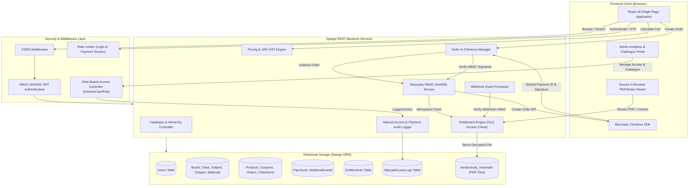
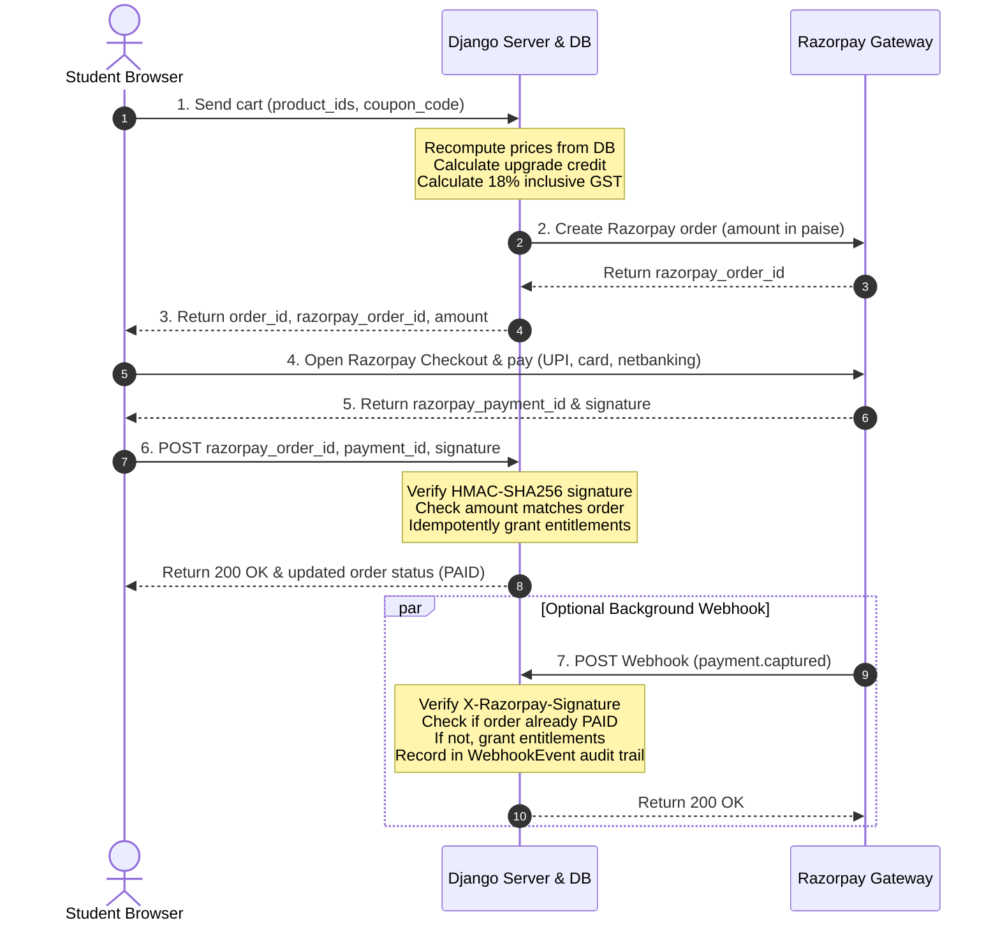

# 🏛️ System Architecture Document: Ed-Tech Platform

---

## 1. Executive Summary & System Overview

The **Ed-Tech Learning Platform** is an enterprise-grade full-stack web application designed for selling, managing, and consuming academic study materials. Content is organized hierarchically:

$$\text{Board} \longrightarrow \text{Class Level} \longrightarrow \text{Subject} \longrightarrow \text{Chapter} \longrightarrow \text{Study Material}$$

Every level of this hierarchy can be sold as a distinct product type:
* **Chapter Notes:** Lifetime access to all notes, videos, and quizzes in a single chapter.
* **Subject Pack:** Lifetime access to all chapters in a subject, including chapters added later.
* **Monthly Pass:** Time-bound access (30 days) to all subjects and chapters in an entire class.
* **Annual Pass:** Time-bound access (365 days) to all subjects and chapters in an entire class.
* **Curated Bundle:** Hand-picked combinations of chapters or subjects at promotional pricing.
* **Free Sample:** 1 chapter per subject accessible to any signed-in student at ₹0.

---

## 2. High-Level Architecture Diagram



---

## 3. Layer-by-Layer Technical Specification

### 3.1 Presentation Layer (Frontend)
* **Framework:** React 18 with modern React Hooks (`useState`, `useEffect`, `useMemo`, `useRef`).
* **Styling & Icons:** Tailwind CSS with modern utilities, glassmorphism cards, and Lucide React Icons.
* **Components:**
  * `CatalogueBrowser`: Multi-level hierarchy selector (Board $\rightarrow$ Class $\rightarrow$ Subject $\rightarrow$ Chapter) with real-time text search.
  * `ProductCard & UpgradeBanner`: Dynamically displays original price, upgrade savings, and ownership states.
  * `CartDrawer`: Real-time subtotal calculation, coupon validation (`WELCOME10`, `FLAT50`), and 18% inclusive GST breakdown (Base, CGST 9%, SGST 9%, Total).
  * `PaymentModal`: Razorpay Checkout modal with fallback simulation modes (`success@razorpay`, `failure@razorpay`, `pending@razorpay`).
  * `StudyReader`: Embedded viewer reading from the secure endpoint `GET /api/materials/<id>/content/`.
  * `LibraryDashboard`: Displays active class passes with day-countdowns and purchased packs.
  * `AdminPortal`: Analytics KPIs, order filter, coupon manager, and manual grant/revoke with logged audit reasons.

### 3.2 Gateway & Middleware Layer
1. **CORS Middleware (`edtech_backend.middleware.CorsAndSecurityMiddleware`):**
   * Preflight `OPTIONS` requests intercepted and returned with `HTTP 200 OK`.
   * Standard headers applied: `Access-Control-Allow-Origin: *`, `Access-Control-Allow-Headers: Authorization, Content-Type, X-Razorpay-Signature`.
2. **Rate Limiting Middleware:**
   * Tracks request timestamps in a sliding 60-second window per client IP.
   * Protects sensitive routes: `/api/auth/login/`, `/api/orders/create/`, `/api/orders/verify/`.
   * Enforces 60 requests/minute max limit with `HTTP 429 Too Many Requests`.
3. **Authentication Layer (`api.authentication.JWTOrTokenAuthentication`):**
   * Validates `Authorization: Bearer <jwt_token>` or `Authorization: Token <jwt_token>`.
   * Verifies HMAC-SHA256 signature using `SECRET_KEY`.
   * Checks expiration (`exp`) timestamp before resolving the active `User` model.

### 3.3 Domain & Business Logic Services

#### Pricing Engine (`api.services.PricingEngine`)
* **Paise Arithmetic:** All operations use integers (paise).
* **18% Inclusive GST Decomposition:**
  $$\text{Base Amount} = \text{round}\left(\frac{\text{Net Amount}}{1.18}\right)$$
  $$\text{GST Total} = \text{Net Amount} - \text{Base Amount}$$
  $$\text{CGST (9\%)} = \lfloor\text{GST Total} / 2\rfloor, \quad \text{SGST (9\%)} = \text{GST Total} - \text{CGST}$$
  $$\text{Base} + \text{CGST} + \text{SGST} \equiv \text{Net Amount}$$
* **Upgrade Credit Calculation:**
  $$\text{Credit} = \min\left(\sum_{\text{owned chapters}} \text{OrderItem.final\_price\_paise}, \text{Product.price\_paise}\right)$$
* **Overlapping Purchase Prevention:**
  * Checks active `Entitlement` records for user.
  * Prevents buying individual chapters if the parent Subject Pack is owned.
  * Prevents buying chapters or subjects if an active Class Pass exists.

#### Razorpay Payment Service (`api.services.RazorpayService`)
* **Order Creation:** Generates Razorpay order via REST API `POST https://api.razorpay.com/v1/orders` using HTTP Basic Authentication `(key_id, key_secret)`.
* **Client Signature Verification (Step 5):**
  $$\text{Expected Signature} = \text{HMAC-SHA256}(\text{key\_secret}, \text{order\_id} + \text{"|"} + \text{payment\_id})$$
  $$\text{Verification} = \text{hmac.compare\_digest}(\text{Expected Signature}, \text{Client Signature})$$
* **Webhook Signature Verification (Step 6/7):**
  $$\text{Expected Header} = \text{HMAC-SHA256}(\text{webhook\_secret}, \text{raw\_body\_bytes})$$
  $$\text{Verification} = \text{hmac.compare\_digest}(\text{Expected Header}, \text{X-Razorpay-Signature})$$

#### Entitlement Engine (`api.services.EntitlementEngine`)
* **Access Verification Hierarchy (O(1)):**
  1. Admin role $\rightarrow$ `True` (Admin access)
  2. `Chapter.is_free == True` $\rightarrow$ `True` (Free sample)
  3. Active `Entitlement(chapter=chapter)` $\rightarrow$ `True`
  4. Active `Entitlement(subject=chapter.subject)` $\rightarrow$ `True`
  5. Active `Entitlement(class_level=chapter.subject.class_level, expires_at > now)` $\rightarrow$ `True`
  6. Otherwise $\rightarrow$ `False` (**HTTP 403 Forbidden**)
* **Pass Stacking Formula:**
  $$\text{Base Start} = \max(\text{now}, \text{existing\_pass.expires\_at})$$
  $$\text{New Expiry} = \text{Base Start} + \text{duration\_days}$$

---

## 4. End-to-End Razorpay Payment Flow Sequence



---

## 5. Security & Access Control Architecture

| Threat / Risk | Architectural Defense | Implementation |
| :--- | :--- | :--- |
| **Price Tampering** | Client never supplies prices; backend queries DB and recalculates all totals, discounts, and GST. | `PricingEngine.calculate_cart_totals()` |
| **Spoofed Payment Confirmation** | Server never trusts browser status. Payments verified via HMAC-SHA256 using server-only `RAZORPAY_KEY_SECRET`. | `RazorpayService.verify_payment_signature()` |
| **Duplicate Fulfillment Race Condition** | Atomic transactions with row-level locks prevent dual grant between client POST and webhook. | `Order.objects.select_for_update()` in `EntitlementEngine` |
| **Unauthorized File Download** | Study materials are not exposed under static URLs. Files stream strictly via authenticated endpoints. | `GET /api/materials/<id>/content/` (HTTP 403 check) |
| **Privilege Escalation** | Admin routes check caller role; student accounts receive HTTP 403 Forbidden. | `IsAdminUserRole` DRF permission |
| **Credential Abuse & Brute Force** | Sensitive authentication and payment endpoints enforce IP-based rate limiting. | `CorsAndSecurityMiddleware` (60 req/min) |
| **Administrative Accountability** | Manual access grants or revocations require a mandatory reason logged permanently to an audit table. | `ManualAccessLog` |

---

## 6. Directory Layout & Key Modules

```
├── ARCHITECTURE.md           # This document
├── README.md                 # Setup, credentials, ER diagram, and operational manual
├── .env.example              # Template of all environment variables
├── requirements.txt          # Python dependencies
├── seed_data.py              # Database seeder (Board, Classes, Subjects, Chapters, Notes, Accounts)
├── verify_e2e.py             # 10-step end-to-end integration test runner
├── manage.py                 # Django management CLI
├── edtech_backend/           # Root Django project configuration
│   ├── settings.py           # Project settings (CORS, REST Framework, Razorpay keys)
│   ├── urls.py               # Main URL dispatcher & SPA view
│   ├── middleware.py         # CORS headers & rate limiting middleware
│   └── wsgi.py               # WSGI entry point
├── api/                      # Core business logic app
│   ├── models.py             # Relational data models (14 models, paise integers)
│   ├── services.py           # PricingEngine, RazorpayService, EntitlementEngine
│   ├── serializers.py        # Request validation and serialization
│   ├── views.py              # REST API controllers & invoice generation
│   ├── permissions.py        # IsAdminUserRole role checks
│   ├── authentication.py     # HMAC-SHA256 JWT authenticator
│   ├── urls.py               # API routes
│   └── tests/                # 16 automated tests
│       ├── test_pricing.py
│       ├── test_signature.py
│       ├── test_idempotency.py
│       └── test_access_control.py
├── templates/
│   └── index.html            # Single-Page Application (React 18, Tailwind, Lucide)
├── frontend/
│   ├── package.json          # Node package configuration
│   └── src/
│       └── api.js            # Centralized API service methods
└── media/
    └── study_materials/      # Uploaded PDF curriculum notes
```
