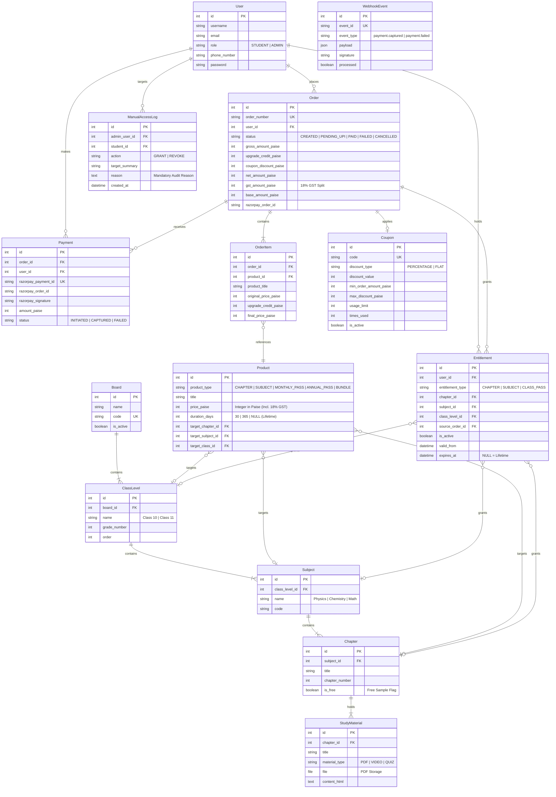

# 📚 Ed-Tech Learning Platform

A full-stack, production-grade Ed-Tech web application built with **Django REST Framework**, **React 18**, **Tailwind CSS**, and **Razorpay Test Mode Payment Gateway**.

Students can browse an academic catalogue (Board → Class → Subject → Chapter), preview free sample chapters, buy individual chapter notes, purchase full subject packs with automatic upgrade credits, buy time-bound monthly/annual class passes, pay securely via Razorpay (UPI, Cards, Netbanking), and read study notes in a protected in-browser document viewer. Administrators have a dedicated portal to manage curriculum, configure pricing & coupons, review orders & payments, view revenue analytics, and manually grant/revoke access with mandatory audit logging.

---

## 🚀 Quick Start (One Command Run)

This application is designed to start with zero complicated setup:

```bash
# 1. Apply database migrations
python manage.py migrate

# 2. Populate seed data (1 Board, 2 Classes, 6 Subjects, 30 Chapters, Products, Admin & Student accounts)
python seed_data.py

# 3. Start the application server
python manage.py runserver
```

Open your browser at **[http://127.0.0.1:8000/](http://127.0.0.1:8000/)** to access the application.

---

## 🔑 Seed Accounts & Credentials

The seed script creates the following pre-configured test accounts and coupons:

| Role | Username / Email | Password | Permissions |
| :--- | :--- | :--- | :--- |
| **Admin** | `admin` / `admin@edtech.com` | `Admin@123` | Full access to Admin Portal, Catalogue CRUD, Orders, Analytics, Manual Access |
| **Student** | `student` / `student@edtech.com` | `Student@123` | Browsing, Purchasing, My Library, Protected Reader, Order Invoices |

### Test Coupons
* `WELCOME10`: 10% percentage discount on order subtotal
* `FLAT50`: Flat ₹50 discount on orders above ₹200

### Razorpay Test Mode Payment Simulations
* **Success UPI:** `success@razorpay` (simulates immediate successful capture)
* **Failure UPI:** `failure@razorpay` (simulates payment declined/failed, allows retry)
* **Pending UPI:** `pending@razorpay` (simulates pending collect request)

---

## 🏗 System Architecture & Technology Stack

* **Backend Framework:** Python 3 + Django 6.0 + Django REST Framework (DRF)
* **Database & ORM:** SQLite (zero-dependency local development) / PostgreSQL ready with Django ORM migrations
* **Frontend:** React 18 SPA + Tailwind CSS + Lucide Icons + HTML5/CSS3
* **Payments:** Razorpay Test Mode API & Checkout SDK with HMAC-SHA256 signature verification & Webhook processing
* **Security & Auth:** HMAC-SHA256 JWT / Token Authentication, role-based route permissions (`IsAdminUserRole`), rate limiting middleware, password hashing with PBKDF2/bcrypt.

---

## 📊 Entity-Relationship (ER) Diagram



---

## 🎯 Key Design Decisions & Correctness Rules

### 1. Money Stored Strictly as Integers in Paise
To eliminate IEEE-754 binary floating-point rounding errors (e.g., `0.1 + 0.2 != 0.3`), all monetary values throughout the database, business logic, calculations, and payment gateways are represented as **positive integers in paise** (1 INR = 100 paise). Conversion to Rupees (`paise / 100`) occurs solely at the presentation layer.

### 2. 18% Inclusive GST Calculation & Split
Prices in the catalogue are shown inclusive of 18% GST as required. The pricing engine derives the exact taxable base and tax components:
$$\text{Base Amount} = \text{round}\left(\frac{\text{Net Amount}}{1.18}\right)$$
$$\text{Total GST (18\%)} = \text{Net Amount} - \text{Base Amount}$$
$$\text{CGST (9\%)} = \lfloor\text{Total GST} / 2\rfloor, \quad \text{SGST (9\%)} = \text{Total GST} - \text{CGST}$$
This guarantees that $\text{Base} + \text{CGST} + \text{SGST} = \text{Net Amount}$ holds true down to the single paisa.

### 3. Entitlements Table (Fast $O(1)$ Access Checks)
Access verification never re-derives permissions from old order histories on every file access. Instead, successful order fulfillment writes explicit records into the dedicated `Entitlement` table. Access checks read the user's active, unexpired entitlements in a single indexed query:
1. Is the student an admin? $\rightarrow$ Access Granted.
2. Is the chapter marked `is_free=True`? $\rightarrow$ Access Granted.
3. Does an active entitlement exist for this `chapter`? $\rightarrow$ Access Granted.
4. Does an active entitlement exist for the parent `subject`? $\rightarrow$ Access Granted.
5. Does an active unexpired pass exist for the parent `class`? $\rightarrow$ Access Granted.
6. Otherwise $\rightarrow$ **HTTP 403 Forbidden**.

### 4. Upgrade Credits (Rule 2)
When a student has previously purchased individual chapters of a subject, the price of the complete Subject Pack is automatically credited by the amount already paid for those chapters (`OrderItem.final_price_paise`), bounded so the price never drops below zero:
$$\text{Credit} = \min\left(\sum \text{Paid for Chapters in Subject}, \text{Subject Pack Price}\right)$$
$$\text{Effective Price} = \text{Subject Pack Price} - \text{Credit}$$

### 5. Time-Bound Pass Stacking (Rule 3)
Purchasing a 30-day monthly pass or 365-day annual pass while an active pass already exists automatically extends the expiration date from the existing expiry timestamp, preventing loss of paid days:
$$\text{New Expiry} = \max(\text{now}, \text{current\_expiry}) + \text{duration}$$

### 6. Idempotent Payment Fulfillment & Webhook Resilience
Access can be granted either by client verification (Step 5) or by the Razorpay webhook (Step 6/7). To prevent race conditions and duplicate grants:
* `EntitlementEngine.grant_access_for_order` uses database row-level locking (`select_for_update`).
* If `order.status == 'PAID'` and entitlements exist, the operation safely returns without re-granting or double-counting.
* Duplicate webhook events with the same `event_id` are identified and return `Already processed`.

### 7. Server-Enforced Route & File Security
* File URLs for study notes are not guessable static files; they are served strictly through the authenticated endpoint `GET /api/materials/<id>/content/`. Unpurchased students receive HTTP 403 Forbidden.
* Students calling admin routes receive HTTP 403 Forbidden via `IsAdminUserRole` permission class.

---

## 🧪 Automated Testing Suite

The repository includes a comprehensive automated test suite covering all four mandatory verification categories:

```bash
python manage.py test api.tests
```

### Verified Test Cases:
1. **`test_pricing.py`**:
   * Exact 18% inclusive GST split reconciliation (`base + gst == total`).
   * Upgrade credit calculation (chapter purchase reduces subject pack price).
   * Coupon discount application (Percentage and Flat amounts with thresholds).
   * Overlapping purchase prevention (cannot buy chapter if subject pack is owned).
2. **`test_signature.py`**:
   * Valid Razorpay HMAC-SHA256 signature verification returns `True`.
   * Tampered/mismatched signature returns `False`.
   * Valid vs tampered webhook signatures against raw request bodies.
3. **`test_idempotency.py`**:
   * Dual arrival of client verification and webhook grants access exactly once.
   * Duplicate webhook event payloads are safely ignored.
   * Time-bound pass extension before expiry stacks durations accurately.
4. **`test_access_control.py`**:
   * Locked material returns HTTP 403 Forbidden for unentitled student.
   * Free sample chapter returns HTTP 200 OK.
   * Purchased chapter, subject pack, and class pass return HTTP 200 OK.
   * Role-based access control blocks students from admin endpoints.

---

## 📁 Repository Structure

```
├── .env.example              # Environment variables template
├── .gitignore                # Git ignore patterns
├── README.md                 # Complete documentation & ER diagram
├── manage.py                 # Django management CLI
├── requirements.txt          # Python dependencies
├── seed_data.py              # Database seeder (Board, Classes, Subjects, Chapters, PDF notes, Accounts)
├── edtech_backend/           # Django project configuration
│   ├── settings.py           # Settings (CORS, REST Framework, Razorpay keys)
│   ├── urls.py               # Main URL router & SPA catch-all
│   ├── middleware.py         # CORS headers & sensitive route rate limiter
│   └── wsgi.py
├── api/                      # Core backend application
│   ├── models.py             # Relational data models (Paise integers, Entitlements)
│   ├── services.py           # PricingEngine, RazorpayService, EntitlementEngine
│   ├── serializers.py        # DRF serializers with request validation
│   ├── views.py              # API views for Auth, Catalogue, Orders, Webhooks, Admin
│   ├── permissions.py        # IsAdminUserRole permission check
│   ├── authentication.py     # HMAC-SHA256 JWT auth implementation
│   ├── urls.py               # API endpoint routes
│   └── tests/                # Automated test suite (16 passing tests)
│       ├── test_pricing.py
│       ├── test_signature.py
│       ├── test_idempotency.py
│       └── test_access_control.py
├── templates/
│   └── index.html            # Complete React 18 Single-Page Application
├── frontend/                 # Modular React component source structure
│   ├── package.json
│   └── src/
│       └── api.js            # Centralized API service methods
└── media/                    # Uploaded study material PDFs and notes
```

---

## 📄 License & Attribution
MIT License. Developed for EdTech Learning Academy Platform — a complete, production-grade educational commerce and content platform.
